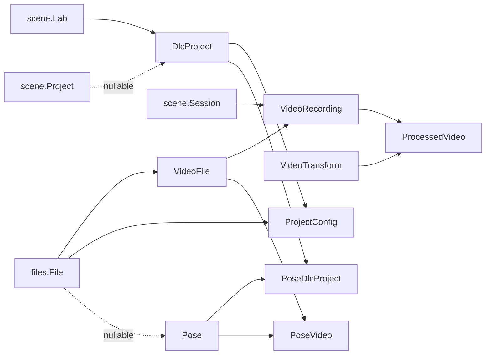

# Videos and DeepLabCut poses

Two optional shared schemas hold what every lab that films its animals, or tracks them with DeepLabCut, has in common:

- `video`: the video files, the videos recorded in a session, and processed copies.
- `dlc`: DeepLabCut projects, the versions of their `config.yaml`, and the poses a model produced.

Both are **preliminary**: their tables may still change before a stable release.
The [onboarding tutorial](../tutorials/02_scene_onboarding_demo.ipynb) uses them end to end on real data.

## Installing

Reading the files needs optional extras; the tables themselves do not:

```bash
pip install "scene-pipelines[video]"      # OpenCV: register_video reads fps, size and frame count
pip install "scene-pipelines[dlc]"        # pandas + PyTables, ruamel.yaml: .h5 poses and config.yaml
```

DeepLabCut itself is never a dependency.

## Tables



| Table | One row per |
|---|---|
| [`VideoFile`][scene_pipelines.schemas.video.video.VideoFile] | video file (by its hash), with fps, size and frame count |
| [`VideoRecording`][scene_pipelines.schemas.video.recording.VideoRecording] | video recorded in a session, numbered by take; optional frame timestamps |
| [`VideoTransform`][scene_pipelines.schemas.video.processing.VideoTransform] | processing recipe of a lab, by a lab code such as `crop-arena` |
| [`ProcessedVideo`][scene_pipelines.schemas.video.processing.ProcessedVideo] | video a transform made from a recording |
| [`DlcProject`][scene_pipelines.schemas.dlc.project.DlcProject] | DeepLabCut project, by a code the lab chooses |
| [`ProjectConfig`][scene_pipelines.schemas.dlc.project.ProjectConfig] | version of a project's `config.yaml`: task, `pcutoff`, bodyparts, individuals |
| [`Pose`][scene_pipelines.schemas.dlc.pose.Pose] | set of poses, such as one DeepLabCut output `.h5`; one `Pose.Keypoint` row per keypoint with its `x`, `y`, `likelihood` |
| [`PoseDlcProject`][scene_pipelines.schemas.dlc.pose.PoseDlcProject], [`PoseVideo`][scene_pipelines.schemas.dlc.pose.PoseVideo] | the project whose model made a pose, the video it was computed from |

Files are identified by their content hash in [`File`][scene_pipelines.schemas.files.files.File]; their bytes are copied
to the file store only when asked (`store=True`). The poses themselves are stored in the database.

A DeepLabCut project folder is named after its task, its labeller and a date. Its `dlc_project_code` is chosen by the lab
instead, and must not name anyone, as for every other code ([Writing data](writing-data.md#subjects-and-sessions)).

## Writing

- [`register_video`][scene_pipelines.ingestion.video.video.register_video]: a video file and its metadata
- [`register_video_recording`][scene_pipelines.ingestion.video.recording.register_video_recording]: a video recorded
  in a session, with its file and optional frame timestamps
- [`ensure_video_transform`][scene_pipelines.ingestion.video.processing.ensure_video_transform],
  [`register_processed_video`][scene_pipelines.ingestion.video.processing.register_processed_video]: a processing
  recipe, and a video it made
- [`register_dlc_project`][scene_pipelines.ingestion.dlc.project.register_dlc_project]: a DeepLabCut project, by code
- [`register_project_config`][scene_pipelines.ingestion.dlc.project.register_project_config]: a version of its
  `config.yaml`
- [`register_pose`][scene_pipelines.ingestion.dlc.pose.register_pose]: a DeepLabCut output `.h5` (offline or DLC-live),
  with optional links to its project and its video, and DLC-live's frame times

```python
from scene_pipelines.ingestion.dlc import (
    register_dlc_project,
    register_pose,
    register_project_config,
)
from scene_pipelines.ingestion.video import register_video_recording
from scene_pipelines.schemas.video.recording import VideoRecording

recording = register_video_recording("videos/mouse1.mp4", session=session)
video = {"file_sha256": (VideoRecording & recording).fetch1("file_sha256")}

project = register_dlc_project("active-sensing", lab=lab, scene_project=scene_project)
config = register_project_config("project/config.yaml", dlc_project=project)
pose = register_pose(
    "videos/mouse1DLC_Resnet50_...h5",
    dlc_project=project,
    video=video,
    frame_times="videos/mouse1_frame_times.csv",  # optional, from DLC-live
)
```

Like the other helpers, each can run again: what is stored is recognised and its key returned.
`register_pose` writes the pose, its keypoints and its links in one transaction.

The lab's own tables then refer to these rows: the onboarding tutorial's `Recording` references a `VideoRecording`,
the `Pose` the lab analyses, and the `ProjectConfig` whose `pcutoff` it uses.

## Reading

Read stored poses back with the read helpers of `scene_pipelines.ingestion.dlc`:

- [`keypoint`][scene_pipelines.ingestion.dlc.read.keypoint]: `x`, `y` and `likelihood` of one keypoint, fetching nothing else
- [`pose_array`][scene_pipelines.ingestion.dlc.read.pose_array]: every keypoint as a float32 `(frames, keypoints, 3)` array
- [`pose_dataframe`][scene_pipelines.ingestion.dlc.read.pose_dataframe]: a DataFrame in DeepLabCut's own column layout

```python
from scene_pipelines.ingestion.dlc import keypoint

x, y, likelihood = keypoint(pose, "nose")
```

## The file readers

The code that reads DeepLabCut's files (`config.yaml`, the output `.h5`, DLC-live's frame times) and a video's metadata
is in the `_transient` subpackages of `scene_pipelines.ingestion.dlc` and `scene_pipelines.ingestion.video`. It belongs
in `dlccore`, the planned public home of DeepLabCut's readers, and moves there once that is released; the tables and
the helpers above do not change.
