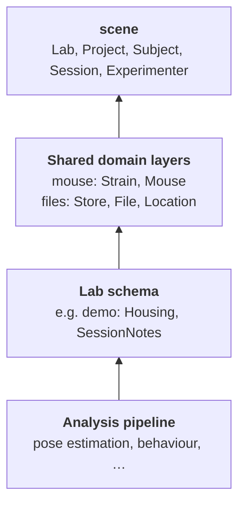

# Introduction

SCENE pipelines is a set of shared [DataJoint](https://datajoint.com/) tables, plus the Python helpers that write to them.
This page explains the ideas behind them. For code, see the [Getting started](tutorials/01_getting_started.ipynb) tutorial.

## Why shared tables

Labs in SCENE collect different data (mice in augmented reality, bats, human participants, …) and each lab has its own
pipeline for it. To combine or compare that data, every lab has to answer a few basic questions the same way:
*which lab, which subject, which session, which project, which file?*

SCENE pipelines provides the tables for those answers. A lab keeps its own tables and analyses, and attaches them to
the shared rows.

## Layers

The tables are organised in layers, from shared to lab-specific:

| Layer | Defined by | Holds |
|---|---|---|
| `scene` | SCENE pipelines | what every lab has: lab, project, subject, session, experimenter |
| `mouse`, `files`, … | SCENE pipelines | what every lab of one kind has: a mouse's sex and strain, a file's content |
| lab schema | the lab | everything else the lab records: cages, rigs, score sheets, notes |
| analysis pipeline | the lab or a tool | results, linked to the sessions and files they come from |

An arrow means "refers to": a lab table points at a shared session, never the other way around.

A table belongs in a shared layer only when every lab that uses the layer needs it, in the same form.
When in doubt, keep it in the lab schema; it can move to a shared layer later.

## Lab codes and ids

Every subject and session has two names:

- a **lab code**, chosen by the lab, such as `mouse-001` or `mouse-001_20260302_1`.
  It is unique within the lab, not across labs.
- an **id**, a random UUID minted by SCENE pipelines the first time the code is registered.
  It is unique everywhere and is the primary key that other tables refer to.

Registering the same code again returns the same id, so the lab keeps working with its own codes, and
`subject_key` / `session_key` find a row by its code.

Codes are shared with the whole consortium, so they must be **pseudonymous**: never a real name, initials, a birth date
or anything else that identifies a person. The helpers accept only letters, digits, `.`, `_` and `-`, which catches
most mistakes but not all; choosing a pseudonym is the lab's responsibility.

Catalog names (a `lab_id` such as `mlai`, a project name, a strain name) are short, stable tokens: chosen once and never
renamed.

## Writing data

Shared tables are written through the helpers in `scene_pipelines.ingestion`, not with `insert1`:

| To add | Use |
|---|---|
| a lab, a project | `ensure_lab`, `ensure_project` |
| a background strain | `ensure_strain` |
| a mouse | `register_mouse` |
| another kind of subject | `register_subject` |
| a session | `register_session` |
| a file | `register_file` (store: `ensure_store`) |

The helpers check the codes, mint the ids, and write the rows that belong together in one transaction.
They are also safe to run again: the same input returns the same key, and the same code with different content raises
an error instead of changing the stored row. An ingestion script can therefore run over all its data every time.

Labs, projects and stores are catalogs for the whole consortium. They are added once, by an administrator; a lab usually
finds its rows already there.

The lab's own tables are written with plain DataJoint.

## Files

A file is identified by its **content**, the SHA-256 hash of its bytes, not by its name or path.
The same bytes are the same row in every database.

- A **store** is a place where file bytes are kept: a lab server, an S3 bucket. Each machine finds a store by its name in
  `dj.config["stores"]`; addresses and credentials never go into the database.
- A **file** is the bytes, by hash and size. It has no name and no meaning of its own.
- A **location** records that a store holds a copy of a file.

Inside a store, a file is kept under a key made from its hash, so a store listing reveals nothing about participants.
The meaning of a file comes from the lab's tables: "the top camera video of this session" is a lab table that refers to
a session and a file.

`register_file` copies a file into a disk store and records it. Copies into S3 are made by a transfer job, which records
them with `record_stored`.

## The lab's own tables

A lab registers its own schema on the same registry as the shared ones, for example
`SCENE_REGISTRY.make_schema("demo")`, and hangs its tables off the shared rows (`-> Session`, `-> Mouse`).
The shared row is the identity: there is no second session id to keep in sync.

A lab that already has a pipeline can keep it, and link its existing rows to the shared ones,
or migrate them. The [MLAI example](tutorials/02_mlai_mouse_ar.ipynb)
does both for a real pipeline.

Importing tables needs no database. `SCENE_REGISTRY.activate_all()` binds every registered schema to the database and
creates the missing tables.

## Advanced

You rarely need these when you start, but you will see them in the database and the API reference.

- **Deployments.** Every database has a deployment id, set once with `SCENE_DEPLOYMENT_ID`, for example `mlai-prod` for
  a lab's production database.
- **Row stamps.** Next to each shared row, the helpers record which deployment wrote it, with which version of the
  helpers, and a hash of its content. These stamps make it possible to compare and sync rows between databases later.
- **Schema versions.** Each schema records the version of its table definitions. The helpers refuse to write when the
  installed code and the database disagree.
- **Table markers.** Each shared table states which database holds the truth for its rows and who may insert them.
  Database administrators use them to set up permissions and syncing.

[Provenance and sync](guides/provenance.md) describes each of these in detail.

## Where next

- [Getting started](tutorials/01_getting_started.ipynb): the same ideas, in code, on a local database.
- [MLAI example](tutorials/02_mlai_mouse_ar.ipynb): a real lab on
  the shared layer.
- [Writing data](guides/writing-data.md) and [Schemas and the registry](guides/schemas.md): the helpers and the
  registry in detail.
- API reference: every table and helper, from the docstrings.
