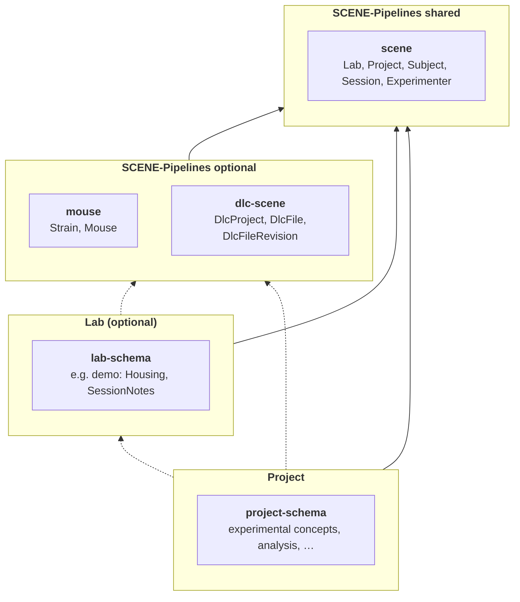

# Introduction

SCENE pipelines is a set of shared [DataJoint](https://datajoint.com/) tables, plus the Python helpers that write to them.
This page explains the ideas behind them. For code, see the [Getting started](tutorials/01_getting_started.ipynb) tutorial.

## Why shared tables

In the SCENE collaboration, our research data and analyses span many species, recording modalities and labs. Yet, without coordination each lab risks building its own database in its own format. Our multidisciplinary breadth only pays off if our data can meet and our analyses share a common structure.

To combine or compare our data, every lab has to answer a few basic questions the same way:
*which lab, which subject, which session, which project?* The SCENE pipelines package provides the tables for those answers. It allows each lab to ingest its acquired data in a common format and synchronize it to a central SQL database on the Simons cluster. The goal is to ensure reproducibility, and a smoother way to share data and run an analysis written in one lab on another lab's data.

## Layers

The tables are organised in different layers, with their own [schemas](https://docs.datajoint.com/explanation/schema-as-workflow-specification/). From shared to lab-specific, the schema relations are  organized as follows:

| Layer | Defined by | Holds |
|---|---|---|
| SCENE shared: `scene` | SCENE pipelines | what every lab and project has: lab, project, subject, session, experimenter |
| SCENE optional: `mouse`, `dlc-scene`, … | SCENE pipelines | what labs of one kind or with one tool share: a mouse's sex and strain, DeepLabCut projects and results |
| lab schema (optional) | the lab | what the lab records across its projects: cages, rigs, score sheets, notes |
| project schema | the project | the project's own experimental concepts and analyses, e.g. MouseAR's datasets and trials |

## Lab codes and ids

Every subject and session has two names:

- a **lab code**, chosen by the lab, such as `mouse-001` or `mouse-001_20260302_1`.
  It is unique within the lab, not across labs.
- an **id**, a random UUID minted by SCENE pipelines the first time the code is registered.
  It is unique everywhere and is the primary key that other tables refer to.

Codes are shared with the whole consortium, so they must be **pseudonymous**: never a real name, initials, a birth date
or anything else that identifies a person. The helpers accept only letters, digits, `.`, `_` and `-`.

Details: [Writing data](guides/writing-data.md#subjects-and-sessions).

## Writing data

Shared tables are written through the helpers in `scene_pipelines.ingestion`, not with `insert1`:

| To add | Use |
|---|---|
| a background strain | `ensure_strain` |
| a mouse | `register_mouse` |
| another kind of subject | `register_subject` |
| a session | `register_session` |

The helpers check the codes, mint the ids, and write the rows that belong together in one transaction.
They are also safe to run again, as long as the content was not changed: the same input returns the same key. The same code with different content raises an error.

### Catalog (admin)
Some special ingestion helpers are created for admin-level registrations:

| To add | Use |
|---|---|
| a lab, a project | `ensure_lab`, `ensure_project` |

 Labs and projects are catalogs for the whole consortium. They are added once, by an administrator from the lab. Normally a lab and other catalog values should already be registered before using a project pipeline.

Details: [Writing data](guides/writing-data.md).

## The lab's own tables

A lab registers its own schema on the same registry as the shared ones, for example
`SCENE_REGISTRY.make_schema("demo")`, and hangs its tables off the shared rows (`-> Session`, `-> Mouse`).
The shared row is the identity: there is no second session id to keep in sync.

A lab that already has a pipeline can keep it, and link its existing rows to the shared ones,
or migrate them. The [MLAI example](tutorials/02_mlai_mouse_ar.ipynb)
does both for a real pipeline.

Details: [Schemas and the registry](guides/schemas.md).

## Advanced

Some functionalities are intended for developers and databases maintainers, but you will see them in the database and the API reference:

- **Deployments.** Every database has a deployment id, set once with `SCENE_DEPLOYMENT_ID`, for example `mlai-prod` for
  a lab's production database.
- **Row stamps.** Next to each shared row, the helpers record which deployment wrote it, with which version of the
  helpers, and a hash of its content. These stamps make it possible to compare and sync rows between databases later.
- **Schema versions.** Each schema records the version of its table definitions. The helpers refuse to write when the
  installed code and the database disagree.
- **Table markers.** Each shared table states which database holds the truth for its rows and who may insert them.
  Database administrators use them to set up permissions and syncing.

[Provenance and sync](guides/provenance.md) describes each of these in detail.

## Where next

- [Getting started](tutorials/01_getting_started.ipynb): the same ideas, in code, on a local database.
- [MLAI example](tutorials/02_mlai_mouse_ar.ipynb): a real lab on
  the shared layer.
- [Writing data](guides/writing-data.md) and [Schemas and the registry](guides/schemas.md): the helpers and the
  registry in detail.
- API reference: every table and helper, from the docstrings.
